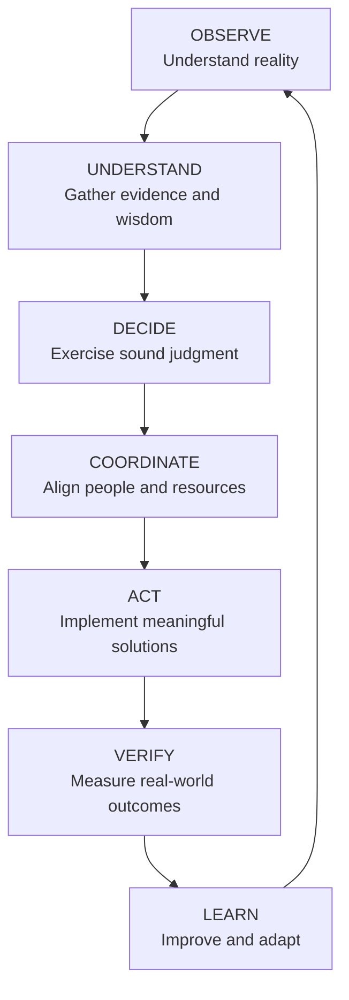

# 🌍 The Flourishing World
### Setting Hearts and Minds Above

> **A world where wisdom becomes discovery, faith becomes action, compassion becomes infrastructure, and innovation becomes a force for flourishing.**

*Building a world in which every person, every community, and all creation have room to flourish.*

---

## About

**The Flourishing World** is a civilisational vision and regenerative development initiative exploring how humanity can build a world where people, communities, institutions, economies, technology, and nature thrive together.

It begins with a simple conviction:

The purpose of human progress is not merely to accumulate wealth, develop technology, or expand our capabilities. It is to cultivate a world in which those capabilities serve life, protect human dignity, restore creation, and expand the possibilities available to future generations.

We envision a future where:

- Wisdom inspires discovery.
- Faith finds expression through service.
- Compassion is embedded in the systems that sustain society.
- Technology strengthens human dignity and agency.
- Economies create shared prosperity.
- Institutions earn public trust.
- Communities shape their own futures.
- Nature is protected, restored, and regenerated.
- Innovation serves humanity and all creation.

This repository is a living foundation for exploring, documenting, designing, and building that future.

## Our Guiding Principle

**Setting hearts and minds above.**

A commitment to look beyond immediate interests, pursue truth, cultivate wisdom, act with compassion, steward creation, and build things that endure.

We believe a flourishing world must be intentionally cultivated through personal responsibility, collective action, ethical institutions, scientific discovery, and purposeful innovation.

## Our Mission

To transform wisdom into discovery, conviction into action, compassion into systems, and innovation into measurable human and ecological flourishing.

We pursue this mission by:

1. Developing a coherent philosophy of human and ecological flourishing.
2. Exploring regenerative models of economic and social development.
3. Designing institutions and infrastructure that enable human potential.
4. Advancing responsible science, technology, and innovation.
5. Supporting community-led solutions to real-world challenges.
6. Connecting knowledge, capital, people, and institutions around shared progress.
7. Measuring outcomes and learning continuously.

---

## The Four Foundational Pillars

### 1. Wisdom → Discovery

Knowledge becomes meaningful when it develops understanding and informs wise action.

We champion intellectual curiosity, scientific research, philosophy, education, historical understanding, cultural knowledge, and lifelong learning.

**Our ambition:** Build a world where everyone has greater opportunities to learn, discover, create, and contribute to humanity's collective knowledge.

### 2. Faith → Action

Faith should be expressed through how we live, serve, create, lead, and care for others.

Inspired by Christian principles of love, stewardship, humility, truth, justice, hope, and service, we seek to translate moral conviction into meaningful action.

We respect human dignity, freedom of conscience, and peaceful coexistence.

**Our ambition:** Make integrity, compassion, responsibility, and service visible in the institutions and systems we create.

### 3. Compassion → Infrastructure

Compassion should extend beyond individual generosity into the structures that organize society.

We explore infrastructure and institutions that expand access to:

- Clean water and nutritious food.
- Healthcare and dignified shelter.
- Education and knowledge.
- Productive livelihoods and economic opportunity.
- Justice and accountable governance.
- Accessible technology and essential services.

**Our ambition:** Build systems that protect the vulnerable, reduce unnecessary exclusion, and expand the capacity of communities to flourish.

### 4. Innovation → Flourishing

Innovation should serve life rather than become an end in itself.

We investigate how science, engineering, technology, artificial intelligence, entrepreneurship, and ecological knowledge can solve meaningful problems.

**Our ambition:** Develop technologies, ventures, and institutions that expand human capabilities, restore ecosystems, and create enduring public value.

---

## A Systems Architecture for Flourishing

A flourishing civilisation cannot be built through isolated interventions.

Its systems are interconnected.

| Domain | Focus |
|---|---|
| Human flourishing | Dignity, health, character, agency and purpose |
| Family and community | Belonging, relationships, culture and social trust |
| Knowledge and discovery | Education, research, science and the arts |
| Health and wellbeing | Healthcare, nutrition, prevention and care |
| Economy and prosperity | Enterprise, employment, investment and shared value |
| Technology and intelligence | AI, digital infrastructure and responsible innovation |
| Nature and regeneration | Biodiversity, water, soil, forests and climate resilience |
| Governance and institutions | Justice, transparency, accountability and participation |
| Culture and meaning | Creativity, heritage, spirituality and craftsmanship |
| Peace and cooperation | Diplomacy, solidarity and peaceful coexistence |

These domains form a connected system in which progress in one area can strengthen the others.

## Our Operating Model

We believe meaningful transformation follows a continuous cycle:



**The central principle:**

Turn complexity into trustworthy intelligence, intelligence into wise decisions, decisions into coordinated action, and action into measurable flourishing.

We distinguish between facts, evidence, interpretations, assumptions, hypotheses, recommendations, and decisions.

We value transparency, explainability, accountability, and continuous learning.

---

## Core Principles

Everything developed under this initiative should be guided by the following principles.

| Principle | Commitment |
|---|---|
| Human dignity | Every person has inherent worth. |
| Truth | Seek evidence and intellectual honesty. |
| Wisdom | Consider moral and long-term consequences. |
| Compassion | Design with the needs of vulnerable people in mind. |
| Stewardship | Care for the resources and responsibilities entrusted to us. |
| Justice | Protect rights, fairness, and meaningful participation. |
| Freedom | Respect conscience, agency, and legitimate differences. |
| Regeneration | Restore the systems that sustain life. |
| Excellence | Build reliable, useful, beautiful, enduring things. |
| Humility | Welcome correction and acknowledge uncertainty. |
| Cooperation | Make collective progress possible. |
| Intergenerational responsibility | Leave future generations greater possibilities. |

---

## Africa: A Place to Build and Demonstrate What Is Possible

Africa has an extraordinary opportunity to contribute to the next generation of human and institutional development.

We believe the continent should be understood not merely through its challenges, but through its people, cultures, knowledge, enterprise, natural wealth, creativity, and capacity for innovation.

Our initial geographical orientation is **Kenya and East Africa**, with a long-term ambition to contribute to flourishing across Africa and beyond.

Areas of exploration include:

- Regenerative agriculture and food security.
- Water systems and watershed restoration.
- Biodiversity and conservation.
- Affordable and accessible healthcare.
- Education and scientific research.
- Youth entrepreneurship and productive livelihoods.
- Digital public infrastructure and financial inclusion.
- Local manufacturing and technological capability.
- Community-led development and accountable institutions.

**Build with communities, not merely for them.**

---

## Technology for Human and Ecological Flourishing

Technology is an instrument of human creativity and responsibility.

We explore technologies that strengthen the infrastructure of flourishing:

- Artificial intelligence and decision intelligence.
- Open-source software and digital public infrastructure.
- Geospatial intelligence and environmental monitoring.
- Data provenance and evidence networks.
- Responsible financial and payment infrastructure.
- Distributed systems and secure information exchange.
- Regenerative capital coordination.
- Community-centred digital services.
- Monitoring, evaluation, and impact verification.

Our technology philosophy is simple:

**Build technology that strengthens human agency, institutional trust, and the capacity of life to flourish.**

Technology must remain accountable to human dignity, privacy, security, environmental responsibility, and legitimate governance.

---

## From Vision to Reality

We do not measure progress by the scale of our language or the sophistication of our concepts.

We measure it by meaningful change.

Our development philosophy follows:

```text
VISION
  ↓
PRINCIPLES
  ↓
REAL-WORLD PROBLEMS
  ↓
EVIDENCE
  ↓
SYSTEM DESIGN
  ↓
PROTOTYPES
  ↓
PILOTS
  ↓
GOVERNANCE
  ↓
IMPLEMENTATION
  ↓
VERIFICATION
  ↓
LEARNING
  ↺
```

Every major initiative should answer:

1. Whose lives or conditions are we improving?
2. What real problem are we solving?
3. What evidence supports our approach?
4. Who participates in designing the solution?
5. What resources and capabilities are required?
6. How will the solution be governed and maintained?
7. What could fail or cause harm?
8. How will we measure meaningful results?

We prefer demonstrated impact over speculative complexity, practical progress over vanity metrics, and durable institutions over temporary excitement.

---

## Measuring Flourishing

Economic growth, technological advancement, and institutional expansion are not sufficient measures of a flourishing world.

We consider progress across several dimensions:

| Dimension | What We Want to Understand |
|---|---|
| Human wellbeing | Are people healthier and living with dignity? |
| Knowledge | Are learning and discovery expanding? |
| Agency | Can people shape their own futures? |
| Economic opportunity | Are meaningful livelihoods becoming more accessible? |
| Social cohesion | Are communities becoming more resilient? |
| Institutional trust | Are institutions becoming more accountable? |
| Ecological health | Are ecosystems recovering? |
| Cultural vitality | Are heritage, creativity, and meaning being sustained? |
| Peace | Are people and communities able to coexist safely? |
| Intergenerational wellbeing | Are future generations inheriting greater possibilities? |

We combine quantitative indicators, qualitative evidence, community perspectives, and independent verification.

We do not reduce the complexity of human flourishing to a single score.

---

## Development Horizons

The vision is multigenerational, but its implementation begins with practical work.

| Horizon | Strategic ambition |
|---|---|
| Present – 1 year | Establish foundations, research priorities, principles, partnerships, and practical pilots. |
| 1 – 5 years | Demonstrate effective community and institutional solutions. |
| 5 – 15 years | Build interconnected, sustainable initiatives and expand proven models. |
| 15+ years | Contribute to enduring institutions and regenerative systems across generations. |

These are planning horizons, not guaranteed outcomes.

---

## Relationship to Atlas Sanctum

[Atlas Sanctum](https://atlassanctum.me) represents one potential technological and institutional contribution to this broader vision.

Its focus on regenerative intelligence infrastructure aligns with the ambition to connect:

- Places and communities.
- Problems and evidence.
- Knowledge and opportunities.
- Capital and interventions.
- Institutions and coordinated action.
- Outcomes and continuous learning.

The Flourishing World provides a broader philosophical and civilisational direction.

Atlas Sanctum explores practical intelligence and coordination infrastructure that can help institutions make better decisions and achieve measurable real-world outcomes.

The two are related, but the vision of flourishing extends far beyond any single organisation or technology platform.

---

## Repository Scope

This repository will evolve as a knowledge and development foundation.

Potential areas of development include:

```text
the-flourishing-world/
│
├── README.md
│
├── philosophy/
│   ├── founding-principles.md
│   ├── human-flourishing.md
│   ├── christian-stewardship.md
│   └── ethics-and-responsibility.md
│
├── civilization/
│   ├── systems-architecture.md
│   ├── institutional-design.md
│   ├── governance.md
│   └── regenerative-economy.md
│
├── research/
│   ├── knowledge-and-discovery.md
│   ├── african-development.md
│   ├── ecological-regeneration.md
│   └── technology-and-society.md
│
├── infrastructure/
│   ├── digital-public-infrastructure.md
│   ├── intelligence-systems.md
│   ├── community-infrastructure.md
│   └── evidence-networks.md
│
├── initiatives/
│   ├── kenya/
│   ├── east-africa/
│   └── global/
│
├── impact/
│   ├── flourishing-indicators.md
│   ├── measurement-framework.md
│   └── verification.md
│
├── roadmap/
│   ├── strategic-horizons.md
│   └── implementation-principles.md
│
└── CONTRIBUTING.md
```

This structure represents a proposed direction, not a claim that all these components have already been implemented.

---

## How to Contribute

A flourishing world is a collective endeavour.

We welcome thoughtful contributions from:

- Philosophers, theologians, and researchers.
- Scientists, engineers, and technologists.
- Educators and students.
- Entrepreneurs and institutional builders.
- Farmers, conservationists, and environmental practitioners.
- Artists, designers, and craftspeople.
- Community leaders and development practitioners.
- Anyone committed to helping people and nature flourish.

Potential contributions include:

- Research and knowledge synthesis.
- Philosophical and ethical frameworks.
- Technical prototypes and open-source tools.
- Institutional and economic models.
- Community development initiatives.
- Ecological restoration approaches.
- Measurement and evaluation frameworks.
- Constructive criticism and documented lessons.

Contributions should be grounded in intellectual honesty, respect, evidence, practical value, and a commitment to human dignity.

See [CONTRIBUTING.md](CONTRIBUTING.md) as the contribution guidelines are developed.

---

## Our Commitment

We will not confuse ambition with achievement.

We will not confuse technological sophistication with wisdom.

We will not confuse wealth with flourishing.

We will not confuse good intentions with effective institutions.

We will remain willing to question our assumptions, learn from failure, collaborate across disciplines, and revise our approaches when evidence demands it.

The vision is ambitious because the needs of humanity and the responsibilities of stewardship are significant.

The work begins with what we can responsibly build today.

---

## The Invitation

Imagine a world where a child can discover their potential, a family can live with dignity, a community can shape its future, a farmer can restore the land, a scientist can advance knowledge, an entrepreneur can create meaningful opportunity, and nature can recover.

A world where institutions exist to serve life.

Where knowledge is shared.

Where resources are stewarded wisely.

Where technology expands human possibility.

Where progress is measured not only by what we accumulate, but by what we enable others to become.

This is not a world we build through declarations alone.

It is a world we build through wisdom, service, cooperation, courage, and enduring work.

**Let us build accordingly.**

---

### Setting Hearts and Minds Above.

*Wisdom into discovery. Faith into action. Compassion into infrastructure. Innovation into flourishing.*

**The Flourishing World**  
*A vision worth understanding. A future worth building. A responsibility worth carrying.*

---

## Connect

- Website: [Atlas Sanctum](https://atlassanctum.me)
- Repository: The Flourishing World
- Geographic starting point: Kenya and East Africa
- Long-term orientation: Global human and ecological flourishing
